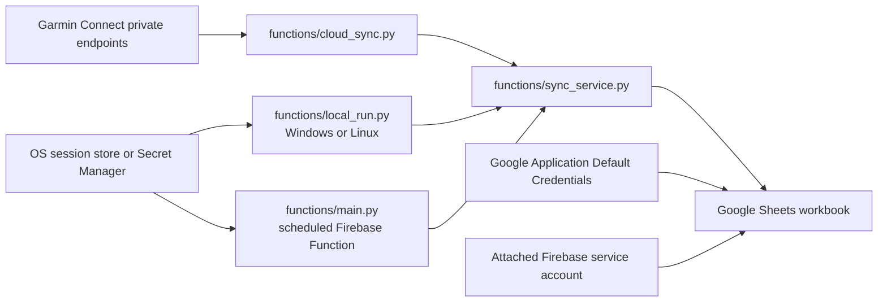

# Architecture and code map

## System shape

The shared portion is the collector, sync orchestration, and Sheets store. The local runner and Firebase entry point are runtime wrappers. They supply configuration, credentials, scheduling, and session persistence. The optional SQLite archive in `garmin_db.py` is a separate local product path and currently has its own collector logic; it is not a destination adapter for the Sheets sync.

## Run sequence

1. Read the workbook's checkpoint, retry queue, and recent correction window.
2. Calculate date ranges for the rolling refresh, historical backfill, and retry records.
3. Collect snapshots, daily records, activities, details, and original activity files from Garmin. Calls use bounded retries and delay.
4. Normalize summary rows and chunk raw JSON or original binary files to fit Sheets cell limits.
5. Upsert rows by stable keys, update changes and errors, and persist the next checkpoint.
6. Append the run record and write the workbook's `README` status marker last.

The Google Sheets API does not provide a transaction spanning multiple tabs. A failure can leave some table writes complete while later writes fail. Stable keys and idempotent upserts allow the next run to repair those rows. Do not treat `RUNNING` as a completed run.

## Where to make a change

| Change | Start here | Preserve |
| --- | --- | --- |
| Add a Garmin endpoint | `functions/cloud_sync.py` | Read-only behavior, bounded retries, failure classification, stable record IDs |
| Change date/backfill behavior | `functions/sync_service.py` | Refresh overlap, retries, checkpoint after data writes |
| Change columns or monthly tabs | `functions/cloud_sync.py` and `functions/sheets_store.py` | Headers, schema validation, stable upsert key, migration/backup guidance |
| Change local authentication or scheduling | `functions/local_run.py` and deployment docs | Secrets outside repo, single-run guard, same sync engine |
| Change Firebase configuration | `functions/main.py`, `firebase.json` | Dedicated runtime identity, Secret Manager, scheduler timezone and limits |
| Change the local SQLite archive | `garmin_db.py` and `tests/test_garmin_db.py` | Idempotent imports, content hashes, ignored sensitive data directory |

## Trust boundaries

- Garmin password is used only at interactive login. The reusable Garmin session is more than a password substitute and must be protected as a secret.
- Google Sheets credentials can write the selected workbook. Share only that workbook with the runtime identity where service-account sharing is used.
- The workbook contains user health and potentially precise location data. Anyone with access to it can read those records.
- Logs and error messages are operational data. They must not include tokens, authorization headers, passwords, or full personal activity payloads.
